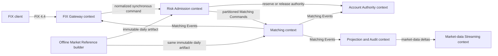

# SimpleMatch domain context

SimpleMatch models a cash-equity order flow in which an external FIX request is normalized, checked
for account and market eligibility, durably admitted, matched deterministically, and projected to
downstream views. The codebase is a single repository, but each service owns a distinct business
capability and language. This document describes those responsibilities, their shared business
language, and the rules that must remain true across requests, retries, and recovery.

## Context map

| Upstream context | Downstream context             | Relationship and translation rule                                                                                         |
|------------------|--------------------------------|---------------------------------------------------------------------------------------------------------------------------|
| FIX client       | FIX Gateway                    | Anti-corruption layer. FIX tags are parsed into gateway-local values before business submission.                          |
| FIX Gateway      | Risk Admission                 | Customer/supplier synchronous boundary. The gateway supplies stable command and FIX identities; risk owns the decision.   |
| Risk Admission   | Account Authority              | Risk requests idempotent reservation work; account-service owns balances, positions, reservations, and their transaction. |
| Market Reference | Risk Admission / Matching      | Conformist startup boundary. Both consumers load the same approved daily artifact bytes and do not reinterpret official source rows independently. |
| Risk Admission   | Matching                       | Published Matching Command language on one explicitly assigned partition. Admission success precedes asynchronous matching. |
| Matching         | Account Authority / Projection / FIX Gateway | Published Matching Event language. Every critical consumer owns durable idempotency and its local state transition. |
| Projection and Audit | Market-data Streaming       | Rebuildable per-instrument snapshots and deltas; streaming never becomes a command path.                                  |

## Bounded contexts and ownership

### FIX Gateway

Owns FIX sessions, inbound normalization and gateway-local validation, durable recording of inbound
intent, and outbound FIX responses. Missing or malformed normalized command values receive a
protocol-level rejection before durable recording and before Risk Admission; valid normalized
commands are recorded before downstream submission. Gateway-local order snapshots and execution
identities translate between FIX and the internal model. A FIX field may be preserved for audit
without being promoted into the internal ubiquitous language.

### Risk Admission

Owns command validation, the admission business key, durable accepted or rejected outcomes, the
admission journal, and reliable publication of accepted commands. An admission command carries its
identity, order facts, FIX identity, and routing reference. A submission result combines its
reference, FIX identity, recorded identity, and outcome. An accepted outcome has no rejection; a
rejected outcome has a stable code and detail. A recorded FIX identity retains whether it is a
storage-safe surrogate; the identity and that distinction travel together.

### Account Authority

Owns account limits, positions, reservations, releases, and fill application. Reservation and
request identities, reservation terms, and execution fills distinguish the order being authorized
from the money and quantity involved. Account Authority owns the transaction and the rules that
depend on the current account and reservation state.

### Matching

Owns deterministic per-instrument order books, time/price priority, fill generation, cancellation,
and expiry. Fifteen fixed Matching owners, one per partition, each own at most 150 instrument
order books. The ordered Matching Command journal is the authoritative input for
processing and replay. Matching does not synchronously depend on projections, market-data clients,
or account persistence after an order has been admitted.

### Market Reference

Owns the offline acquisition, normalization, validation, and construction of one immutable Market
Reference Artifact for each Asia/Taipei trading day. The artifact contains reusable market rules,
instrument facts and eligibility, and complete stable routing assignments for all Phase 1 eligible
XTAI and ROCO regular-board common stocks. Risk Admission and all Matching owners load the same
approved file bytes at startup. Market Reference is an offline capability with no event-publication,
consumer-projection, or trading-path lookup responsibility. A future trading day's artifact may
assign an instrument to a different route, but the current trading session's topology and assignments
remain immutable after readiness opens. Runtime market-data projection and client streaming are outside
this boundary.

### Operational Coordination

Owns the trading readiness and admission decision by composing independently owned facts: the
approved artifact identity, Risk status, all 15 Matching ownership/recovery statuses, the required
partition topology, and critical-consumer progress. In Phase 1 this capability lives inside the
single FIX Gateway application boundary. If a required dependency fails after open, the Gateway
pauses new admission or interrupts the market according to severity without
mutating the artifact or reassigning a partition. Recovery never reopens admission automatically.

### Market-data Streaming

Owns rebuildable runtime market views derived from Matching execution and book-change facts, the
latest snapshot with sequence metadata, and client stream delivery. Its planned baseline is
the last trade and top-five book for each instrument, including snapshot-before-delta delivery,
gap detection, resynchronization, and slow-consumer handling. Historical analytics and broader
per-instrument metrics such as OHLCV, turnover, and VWAP require a separate specification and are
outside this baseline. Market-data Streaming does not own instrument reference facts,
Routing Policies, order books, executions, or durable audit history.

### Query

Owns required Phase 1 read-only views for order state, executions, account summaries, and the active
Market Reference Artifact. Its projections are rebuildable downstream views,
never command authority. Query does not read another service's database, join service-owned schemas,
or make admission, reservation, Matching, or delivery decisions. A Query outage degrades reads but
does not pause the trading path.

### Projection and Audit

Owns rebuildable query projections and audit integration. Projection state is downstream of
authoritative lifecycle events and must not become a second command path.

## Ubiquitous language

| Term                   | Meaning                                                                                               | Owner                                        |
|------------------------|-------------------------------------------------------------------------------------------------------|----------------------------------------------|
| Admission              | Durable decision that a normalized order may enter the ordered matching path.                         | Risk Admission                               |
| Admission aggregate root | One Risk Admission lifecycle for a command identity, from pending intent to accepted or rejected outcome. | Risk Admission                               |
| Submission             | One normalized request evaluated and persisted as accepted or rejected.                               | Risk Admission                               |
| Admission business key | FIX sender, target, trading day, command category, and client-order identity used for idempotency.    | Risk Admission                               |
| Reservation            | Account-owned authority held for an admitted order.                                                   | Account Authority                            |
| Account limit          | Daily notional authority for one account and trading day, including its reserved and utilized amounts. | Account Authority                            |
| Account position       | Symbol-level inventory authority for one account, including long, short, and reserved quantities.    | Account Authority                            |
| Execution fill         | One idempotent matched quantity at one execution price.                                               | Matching produces; Account Authority applies |
| Resting order          | An order's unfilled remainder waiting in the order book for a compatible opposing order; prior partial fills are possible. | Matching                                    |
| Release                | Terminal removal of remaining reserved authority.                                                     | Account Authority                            |
| Market snapshot        | Versioned set of instrument eligibility and trading rules.                                            | Market Reference                             |
| Routing policy         | Complete stable assignment of every eligible instrument to one of 15 fixed Matching partitions for one trading day. | Market Reference                             |
| Market Reference Artifact | Immutable canonical JSON containing metadata, market rules, instrument facts, eligibility, and the Routing Policy; Risk and Matching load the exact same bytes. | Market Reference                             |
| Artifact identity      | One trading day plus the SHA-256 of the exact final artifact UTF-8 bytes; it is supplied outside the JSON. | Market Reference                             |
| Trading session        | One coordinated Phase 1 regular-board lifecycle from Open Barrier through Close Barrier for one Asia/Taipei trading day. | Operational Coordination                    |
| Open Barrier           | Ordered command in every Matching partition that establishes the trading session, artifact, algorithm version, and replay baseline. | Risk Admission publishes; Matching applies  |
| Close Barrier          | Ordered command in every Matching partition after admission drains; it expires remaining ROD orders and closes that partition deterministically. | Risk Admission publishes; Matching applies  |
| Matching Command       | Stable-identity new-order, cancel, Open Barrier, or Close Barrier input to the ordered Matching journal. | Risk Admission                               |
| Matching Event         | Deterministic Matching result, including trade, rested, cancelled, and expired facts. | Matching                                    |
| Command identity       | Stable identity of one requested Matching action; transport redelivery never creates a new command identity. | Ingress owner                                |
| Order identity         | Stable identity of one order throughout creation, matching, cancellation, and expiry.                   | Risk Admission creates; contexts reference  |
| Event identity         | SHA-256 identity of one command output slot within a trading session and partition.                     | Matching                                    |
| Trade identity         | SHA-256 identity of one deterministic match slot within a command.                                      | Matching                                    |
| Output index           | Zero-based order of all externally published events produced by one Matching Command.                   | Matching                                    |
| Match index            | Zero-based order of only the trades produced by one new-order Matching Command.                          | Matching                                    |
| Maker                  | For one trade, the order already resting in the order book and providing liquidity.                     | Matching                                    |
| Taker                  | For one trade, the incoming order that removes resting liquidity; the role is per trade, not permanently buy or sell. | Matching                                    |
| Aggressor side         | The side of the incoming order that removes resting liquidity in one trade.                              | Matching                                    |
| Critical consumer      | Consumer whose failed record cannot be skipped because it owns permanent trade, account, or FIX-delivery effects. | Consuming context                            |
| Quarantine             | Durable evidence that a critical consumer stopped before a record whose identity, payload, sequence, or schema cannot be applied safely. | Consuming context                            |
| Partition Ownership Permit | Permission for one Matching owner to process only its assigned partition. | Matching infrastructure                     |
| Matching Fleet Status  | Operational status of all 15 Matching owners, including identity, permit, artifact, recovery, lag, and quarantine. | Matching infrastructure                     |
| Trading System Status  | Gateway-owned decision value combining Risk, Matching Fleet, partition topology, and critical-consumer readiness into open, pause, or interrupt eligibility. | Operational Coordination                    |
| Trading readiness barrier | Operational boundary that opens only when the daily artifact identity, trading session, schemas, 15-partition topology, Matching ownership, and critical-consumer health all agree. | Operational Coordination                    |
| Regular trading session | Single continuous cash-equity trading period from market open to market close; it is not divided into morning and afternoon sessions. | Market Reference                             |
| Market instrument      | Instrument known to a market snapshot, with complete trading rules and explicit eligibility. It may be known but ineligible. | Market Reference                             |
| Eligibility reason     | Market Reference explanation of whether a known instrument is tradable. Unsupported is valid snapshot data; malformed is not. | Market Reference                             |
| Instrument order book capacity | Maximum number of eligible market instruments whose order books one Matching route may own.     | Matching                                    |
| Last-trade view        | Rebuildable per-instrument view of the latest published execution, with sequence metadata for consistent delivery. | Market-data Streaming                        |
| Top-five book view     | Rebuildable per-instrument view of the five best price levels on each side, derived from Matching book-change facts. | Market-data Streaming                        |
| WAL record             | Replay-safe gateway persistence representation of inbound FIX intent; not an aggregate.                | FIX Gateway                                  |
| Journal row            | Persistence representation of the Admission aggregate; not a transport-facing contract.              | Risk Admission                               |
| Outbox record          | Infrastructure representation used to publish a domain/integration event atomically with local state. | Producing context                            |

## Modeling rules

1. Distinguish values by business meaning and invariant. Order identity is not account identity;
   fill quantity is not fill price, even when their external representations look alike.
2. An application command asks one context to perform one use case and groups values by meaning.
   External requests, stored records, and published events are translated at context boundaries.
3. Do not introduce a repository-wide enterprise domain model. Share only stable cross-context
   contracts and primitive value semantics; each bounded context owns its own aggregate and
   language.
4. Application services own business transactions. Domain values validate context-free invariants
   before a transaction; locked aggregates and application services validate state-dependent
   invariants inside the transaction.

## Aggregate and consistency boundaries

Account Authority has three separate aggregate roots: Reservation, Account limit, and Account
position. Reservation owns one reservation's lifecycle and quantities; Account limit owns the
daily notional invariant for one account; Account position owns the quantity bounds for one account
and symbol. Reservation lifecycle operations may coordinate a reservation root with the relevant
limit or position root in one local transaction; no single Account root owns every position and
reservation.

The Reservation lifecycle owns the state of one Reservation: remaining and filled quantities,
held authority, outcome, and revision history change together in an account-service transaction.
Release ends only unused authority; it never reverses an applied fill or cancels the matching
order that owns the reservation. The lifecycle rejects combinations that conflict with its state:
accepted authority remains allocated, rejection has no fill or held authority and has a stable
reason, release has no remaining or held authority, and an applied reservation is fully filled.

Account limit and Account position retain separate identity, state, and revision values. A daily
notional ledger is not interchangeable with symbol-level inventory.

Risk Admission has one Admission aggregate root per command identity. It owns the normalized order
facts needed for the decision, the alternate admission business key, and the lifecycle from pending
intent to an accepted or rejected outcome. Account reservations and matching orders are separate
context-owned roots; an admission may reference their outcome or publish an accepted decision, but it
does not own their state.

An Admission journal entry composes the validated Admission command, its fixed delivery route, and
its lifecycle. The command retains the ingress routing reference; the delivery route retains the
authoritative Artifact identity and resolved Matching partition as one persisted pair. A new
Admission resolves that pair exactly once before Account Authority work. Every persisted Admission
has both values, and recovery reuses the pair without reconstructing or recomputing either value.
The lifecycle owns state, reservation or rejection outcome, and revision history, while an
admission response remains a separate projection.
Admission lifecycle outcomes are state-specific: pending has no decision, an accepted new order has
a reservation reference, an accepted cancellation explicitly requires none, and rejection has a
stable nonblank code and detail.
An Admission result is a projection of Admission identity, decision, routing-policy provenance,
and delivery route. It does not duplicate journal revision history or complete order facts.

Each aggregate root owns its state-dependent invariants. Reservation changes must use Account
Authority's transaction-owning application boundary and must not bypass coordination with account
limits, positions, and required event publication. Publication records are infrastructure owned by
Account Authority rather than Reservation state.
The admission journal and outbox are changed atomically inside risk-service-owned transactions.
Risk Admission owns synchronous validation, backpressure, and remote account reservation
orchestration. Its pending-admission recovery owns scheduled retries and keeps remote reservation
work outside local transactions; failed pending admissions remain eligible for a later bounded pass.
Cross-service calls never extend a database transaction across service boundaries;
retry requires an idempotency identity, and asynchronous consumers own inbox/deduplication state.
These boundaries take precedence over convenience abstractions that would hide transaction
ownership.

## Implementation and operations references

- [Domain-value implementation](docs/adr/0002-domain-values-for-wide-call-boundaries.md) documents
  concrete types, ingress composition, and persistence mapping. The subsequent
  [parameter-safety refactor](docs/refactoring/domain-parameter-safety-refactor.md) records the
  current interface policy and completed migrations.
- [Consistency and recovery](services/docs/platform/consistency-recovery-identity-and-errors.md)
  describes durable admission, identity mapping, retry, and event-delivery mechanisms.
- [Matching ingress](services/docs/architecture/matching-ingress.md) describes the processing core
  and its input/output path; [event contracts](services/docs/contracts/kafka-events.md) define the
  shared records and their delivery rules.
- [Configuration ownership](services/docs/platform/configuration.md) describes shared capabilities
  and service-owned settings.
- [Deployment](services/docs/platform/deployment.md) and
  [Matching fleet recovery](services/docs/platform/matching-fleet-recovery.md) describe runtime
  placement, partition ownership enforcement, and operator procedures.
- [Local certification](docs/production-live-certification.md) describes the Phase 1 release gate,
  local evidence, image identities, and the separate external deployment templates.
