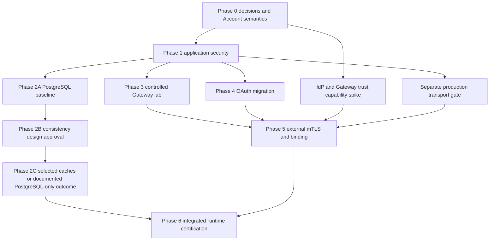

# Query Security and Cache Implementation Plan

Status: **Approved design with historical Phase 1 publication/start records. Later phases remain separately gated**.
Original baseline: `9e68995233f49319974b76f826a59f88f14538cb`.
Phase 0 source refresh: `8362a165e9ce05dc91247b55c9587866840a32ce` (2026-10-23),
clean before the documentation-only decision round. FIX/Redis changes are committed;
Query HTTP identity, account grants and incoming HTTPS remain unimplemented in this baseline.
This plan implements the approved directions in the
[revised specification](../../services/docs/query-service/security-external-access-spec.md),
[decision register](../../services/docs/query-service/security-decision-register.md) and
[Account review](../../services/docs/query-service/account-summary-semantics-review.md).
GitHub Issues own execution state; this file owns planned scope and gates, not live checkboxes.

Phase 1 authorization and ticket-state statements below describe their recorded planning rounds.
For current delivery status and evidence, see [QS1-07 / #194](https://github.com/WenHsuanYu/SimpleMatch/issues/194).
This revision grants no new implementation approval and reports no new runtime result.

## 1. Phase dependencies and claim boundaries

Phases 2 and 3/4 need not wait for one another after their prerequisites, but only the approved
phase may be implemented. Lab application PASS is not a production transport PASS. Phase 6
aggregates phase evidence and cross-phase failures; essential phase tests are not deferred to it.
No new cache is a valid outcome if PostgreSQL-only meets requirements or correctness is unproven.

## 2. Phase 0 — decisions and bounded implementation readiness

1. Refresh HEAD/status and separate unrelated changes. Confirm actual dependencies/locks,
   Query HTTP routes, configuration authority, consumers and overlay output. Obtain the original
   finding/owning issue if available; do not invent issue scope or close it without evidence.
2. Resolve OD-01/02/04/17 and initial OD-03: M2M consumers, grant approval, emergency isolation,
   effective revocation/in-flight/rollback semantics and candidate SLO measurement. Name the
   policy provisioning source and precedence. Do not infer business authority from Kubernetes RBAC.
3. Q7 confirms the no-approved-usable-IdP prerequisite through the project owner (OD-05/15),
   selecting initial opaque lab authentication. Phase 1 security comes first and OAuth is
   deferred; discovery of an approved IdP reopens the
   mode decision, not automatic Phase 4 execution.
4. Q9 approves the Lab route matrix: sensitive reads with grants/ownership, independent operator
   POST, minimal health, operations-read Freshness, authenticated Market Reference and management
   default denial. Resolve embedded Freshness disclosure and exact HTTP/filter behavior.
5. Approve the Phase 1 Account description under OD-19: current reservation-related projection,
   not balance aggregation. New domain semantics require a separate scope decision. Record
   external schema/monotonicity blockers without requiring a complete aggregate redesign to
   repair account authorization.
6. Choose lab-only or staging/production delivery; production needs OD-16 transport design.
   Identify compatibility changes and approved acceptance fixtures before editing implementation.

Gate: written decisions plus the exact Phase 1 slice are approved. Unselected production IdP,
Gateway and PKI details do not automatically block a lab security slice, but must remain
explicitly unclaimed. No production security secrets or numerical SLAs are invented.

The [Phase 0 decision round](../../services/docs/query-service/security-decision-register.md#phase-0-decision-round-1)
owns the current questions and answer status. The user selected M2M clients, isolated Local Lab
delivery and protection of the existing reservation-related projection. Resolve the remaining
dependent identity/policy/revocation/route
contracts. Do not publish Phase 1 execution tickets or begin an integration branch before those
decisions and the bounded Phase 1 scope are approved. Existing later-phase gates remain unchanged.

Later security phases must support development-environment validation with synthetic identities
and replaceable trust/issuer configuration. Local test-CA issuance is a candidate, not a selected
production PKI or a reason to disable certificate checks. Preserve the same application grants
and final binding semantics across environments; separately verify production provisioning,
identity, rotation, revocation and ingress before claiming production readiness.

Round 2 approves user ownership of the Local Lab test Principal/synthetic Account grant matrix
only. A controlled Fixture Provisioning process generates credentials before deployment; never
hardcode or commit them, and never generate independent credentials inside Query Pods.
Nonsecret fixture identities/matrices may be versioned. Rotation, disabled-principal,
revoked-grant and cross-principal HTTP tests are mandatory. Production grant governance,
Secret management and emergency responsibility remain separately unresolved.

The user's future authoritative available-trading-capacity objective is retained in the
[Account priority assessment](../../services/docs/query-service/account-summary-semantics-review.md).
Cash-balance engineering is excluded from this roadmap by round 2.
Its domain contract is a prerequisite for a new authoritative account-data product, not for
repairing authorization on the current projection. No Account/Risk implementation is included
in the approved documentation task or automatically added to Phase 1.

## 3. Phase 1 — authentication, grants and PostgreSQL-only sensitive reads

### Acceptance contract

- Real HTTP security filters establish a registered principal before sensitive controller work.
- Explicit grants protect all three sensitive endpoints; parent order existence and trusted
  ownership precede executions; returned identities and each execution are checked.
- All four business routes bypass Redis response reads AND writes, including Market Reference
  and old-key/envelope bypasses. Full operations freshness remains a PostgreSQL read.
- Preserve operator-token separation, no implicit admin, no FIX privilege inheritance.
- Enforce 401/404/400/unavailable semantics, appropriate challenge and no-store responses.
- Validate policy snapshots and expose only nonsecret effective version. Exercise rotation,
  emergency isolation, interrupted rollout and anti-rollback under the approved initial contract.
- HTTP/PostgreSQL integration evidence is required, not only mocks/H2. Lab synthetic transport
  and production verified HTTPS are separate acceptance claims.

### Proposed small cohesive implementation slices

| Order | Work, tests first | Verification before advancing |
| --- | --- | --- |
| 1 | Add HTTP negative cases and validated principal/policy configuration. Separate credential identity, principal and explicit grants; immutable request policy snapshot. | Missing/disabled/ambiguous credentials, invalid UUID grants, rotation overlap, policy-version tests. |
| 2 | Wire framework authentication/security context using approved mode; explicit route/method allowlists, stateless behavior and no weaker default login scheme. | Real filter-chain 401 and malformed-input ordering; forged headers, FIX/operator credentials, unsupported methods/routes. |
| 3 | Introduce one cohesive authorized-read application module and thin controller. Reuse Query store; constrain detail reads by authorized resource/account; resolve parent/order race without assuming ownership immutability. | Two principals/two accounts, multiple grants, unknown/unauthorized indistinguishable 404, existing order with empty executions, inconsistent durable rows fail closed. |
| 4 | Remove Account/Order/Executions AND Market Reference cache reads/writes. Do not broadly delete Redis keys or rewrite Redis TLS/ACL work. | Preseed old/misleading envelopes for all four routes; authorized HTTP results use PostgreSQL and never return cached checkpoint fields. |
| 5 | Preserve rebuild authentication through explicit security-chain/CSRF rules; keep probes minimal. Update dedicated certification credentials, fixture selection, sensitive key-presence checks and docs. | Rebuild token cannot read accounts; read credential cannot rebuild; fixed granted fixtures; health/placement/internal consumers remain intentional. |
| 6 | Add the approved policy deployment/emergency procedure and, only if authorized, native HTTPS transport. | Multi-replica version/old-connection/in-flight/rollback evidence; production credential traffic only on verified encrypted channels. |

A3/A4 expand slices 1/2/5/6: specify principal lifecycle and non-recycling; policy schema/version
and mapping validation; a single environment policy authority; Secret adoption and coherent
authentication/authorization snapshots; complete status/challenge/cache headers, generated
HEAD/OPTIONS and chain-specific CSRF/session rules. Slice 4 proves A1 through sensitive-cache
non-use. Use the amendment matrix in section 11 as acceptance cases, not deferred Phase 6 work.

Authentication and grants should not become generic strategy frameworks. Public/non-obvious
Java members need Javadocs. Use records for simple immutable values and normal application
transaction ownership; keep JDBC in thin adapters. No Account schema joins, new online
entitlement service, distributed lock, OAuth server or Kafka entitlement stream.

### Compatibility and failure handling

Unauthenticated collectors become 401. Unknown execution parent changes from apparent empty
success to 404. Authenticated invalid UUID remains 400; unauthenticated invalid UUID is rejected
at authentication. Remove response-key existence expectations for all four business routes,
including Market Reference, while retaining independent Redis TLS/ACL/namespace tests.
Inventory external clients before promising payload compatibility. Old caches may remain unused;
restoring the old insecure application is not an approved rollback. Use a secure compatible
rollback or stop protected reads. Policy rollback cannot restore revoked grants.

### Q8/Q9 feasibility and acceptance additions

The approved policy-transition direction is Block → Drain → Activate → Verify → Resume.
Q10 selects controlled full-process shutdown for Local Lab, pausing projection consumption.
Application-only read gating is a later alternative, requiring a protected gate, acknowledgement
and coordinated activation. Existing two-replica RollingUpdate with maxUnavailable zero is not
the approved revocation procedure. A readiness change, EndpointSlice removal or successful
scale command alone is not proof of blocked direct requests or terminated old processes.
Full shutdown must verify termination or reliable fencing; a force-deleted API object alone
does not prove that a process on an unreachable node stopped. No projection reset or Kafka offset
reset accompanies a grant-policy change. Preserve and measure catch-up after any consumer pause.

Candidate anti-rollback procedure: maintain the approved immutable policy version/digest outside
the application release artifact, under separate update authority; restrict deployment/resume
to that artifact and compatible secure images. Validate schema/content at startup through Spring
Environment. Test stale policy references, same-version altered content, old image with current
policy, and an image that cannot enforce the current contract. Unsafe rollback stays unavailable.
This is a procedural Lab candidate, not a selected storage system or a hard guarantee against
an administrator able to alter both authority and deployment. Do not add another configuration
loader, distributed lease or online authorization service merely for this lab.

| Scenario | Required evidence before accepting the corresponding capability |
| --- | --- |
| Block/direct access | New requests over existing keep-alive, Pod, ClusterIP and allowed port-forward paths cannot escape maintenance; observe actual old-instance state, not just Service readiness. |
| Drain | Test the approved allowance for admitted requests, server-side/request/DB deadlines and forced termination; distinguish grace budget from measured completion. Bytes already sent cannot be recalled. |
| Failed V2/partial activation | Malformed policy, missing secret, failed replica and interrupted updater keep protected reads blocked; no automatic V1 rollback. |
| Verify/Resume | Inspect each eligible replica's active policy identity and test revoked access; no stale/newly recreated replica joins later with old policy. Service load-balancing samples alone are insufficient. |
| Projection pause | Preserve offsets/checkpoints, observe restart duplicates/catch-up and report actual freshness; security-ready is not a claim of zero projection lag. |
| Rebuild chain | Operator-only valid request succeeds when enabled; missing/wrong operator and Query-token-only requests fail; operator token cannot read account data; disabled route/method variants remain denied. |
| Permission isolation | operations-read principal has no account grants; ordinary principal cannot read /freshness; both may read Market Reference per Q9. |
| Consumers | evidence.sh uses explicit fixture-granted reads and separate operations credential; Java placement uses operations identity for /freshness and minimal probes for health. No global anonymous compatibility mode. |
| Embedded freshness | All four ordinary routes return the minimal envelope from PostgreSQL; preseed full old cache JSON and prove it cannot disclose checkpoints; revise collector schema assertions. |

Q12 selects omission of full operational checkpoint metadata from ordinary
responses and retention on operations-read /freshness. Propose remaining summary fields and
compatibility explicitly; do not assume an endpoint permission filters an existing response DTO.
Market Reference joins the other business routes in bypassing both response-cache reads and
writes in Phase 1. Typed cache design is deferred until Phase 2A measurements and 2B/2C gates.

### Phase 1 consolidated design review package

Status: **seven tickets published; the user authorized only #188 / QS1-01 to start implementation**.
Q1–Q12 directions and the subsequent five-point simplification are recorded below. Accepted Lab
test parameters are hypotheses to verify, not measured capabilities or commercial SLAs.
Unselected implementation details remain proposals within this bounded scope.
The consolidated to-tickets review is complete; the user approved publication of the revised seven-ticket breakdown.
Do not launch a further open-ended numbered interview for ordinary implementation choices.

#### P1-01 — scope and configuration

Implement Query-only application security and isolated synthetic-fixture certification. Keep
the approved route matrix and PostgreSQL-only Account/Order/Executions/Market Reference. Preserve trading paths,
Account/Risk authorities, Redis transport/ACL isolation and the independent rebuild credential.
No production rollout, Gateway/OAuth/PKI, new service, schema migration, account-capacity event
redesign or Phase 2 optimization is in this package. Any necessary Lab configuration lives in
existing test/overlay conventions, without changing the production deployment by default.

Bind one security-policy object using Spring Environment and @ConfigurationProperties. In the
Kubernetes Lab, use the existing Query Secret import convention as the sole security-property
publisher; provide a complete validated policy snapshot, not partially competing grants from
ConfigMaps/env overrides. Non-Kubernetes HTTP tests supply the equivalent properties through
test configuration. Missing mandatory policy, conflicting source ownership, unsupported schema,
invalid mappings or incompatible image/policy prevents protected serving. Do not implement a
custom YAML loader or a second runtime configuration authority.

#### P1-02 — identity, credentials and fixture contract

Use immutable registered QueryPrincipal IDs with independent credential IDs, explicit account
sets and operations-read. A request retains one validated policy snapshot through authentication
and authorization. Principal IDs are never recycled within an active Lab lifecycle; preserve
retired status through that run's ordinary policy updates. Disabled/retired principals cannot
authenticate. Removing their active grants and disabling credentials is one coherent policy
change. Reactivation requires explicit approval;
it does not restore old grants automatically.

The controlled Fixture Provisioning process generates credentials before deployment and supplies
all replicas with the same approved credential mapping and Policy Version through Spring
Environment configuration. Query loads and validates that policy, never issues per-Pod credentials.
QS1-01 owns application loading/validation; QS1-06 owns cross-deployment rotation, convergence and
revocation evidence. The precise verifier format remains a reviewed implementation choice.

Proposal: the provisioner generates 32 random bytes per opaque credential, delivered only through
protected ephemeral files/Secret provisioning. Store SHA-256 verifiers of high-entropy credentials,
not reusable plaintext; use bounded parsing and constant-time fixed-size verifier comparisons.
No password-style low-entropy credentials, shell tracing, token command-line arguments, raw
headers in reports or secrets in fixtures. Clear temporary client material after the run under
the repository's exact-owned cleanup rules. Query does not need secret-generation permission.

Approved-in-principle nonsecret authorization matrix: client A reads synthetic account X,
client B reads Y, client C reads X and Y, operations client has operations-read and no accounts, and client D has
neither permission nor grants. All registered enabled clients can read Market Reference. Use
explicitly generated fixture IDs, with actual IDs mapped into the approved matrix at runtime;
do not pick a random existing account then broaden access. Disabled/retired fixture principals
have no active grants. The user approves this matrix, not permanent customer governance.

For each of X/Y, provision an Order with at least one Execution and an Order without Executions;
record canonical IDs and expected Order/Account ownership. Reserve a never-inserted Order UUID
and verify its absence: a missing parent is 404, not an empty successful collection. Integrity
corruption cases use isolated variants. V2 revokes only C→Y; C→Y must be denied while C→X and
B→Y remain successful, with all other permissions unchanged. QS1-06 proves this on Account
Summary; QS1-07 extends it across the completed Order/Execution routes and all serving replicas.
The independent rebuild operator is outside this matrix; test both directions of credential
misuse. Detailed fixture and post-revocation tables are in the ticket review packet.

#### P1-03 — independent policy approval and rollback protection

Maintain a small protected run-owned approval record outside the application image/release
bundle: the current approved policy version/digest, associated with this run's identity. The
controlled deployment procedure must not replace V2 with V1 during this test lifecycle. Runtime
policy properties still come solely through Spring Environment; the approval record does not
dynamically merge grants into requests. Do not build a central policy database, enterprise
approval platform or permanent cross-Lab principal-retirement registry.

The controlled deployment/resume procedure rejects older versions, same-version changed content,
missing authority records and incompatible images. It must preserve the approved record across
an image rollback and ordinary runner restart; losing it is a blocked recovery, not permission
to recreate V1. Version advances require approval; a higher number alone does not approve new
grants. Keep credentials out of approval evidence and restrict who can replace the record or
resume deployment. Preserve principal retirement within the run using its policy/test records;
no independent permanent retirement store is required. Image compatibility is a deployment
validation, not a new enterprise registry.

After verified teardown of the entire disposable run, a new namespace, new synthetic identities
and new fixture data may start at its own initial policy version. Record teardown/run separation
so restarting a runner, losing the record or retaining old Pods/identities cannot masquerade as
a fresh run. No global monotonically increasing version is required across independent Labs.
This exception does not apply to production or any environment with persistent client identities.

An application process cannot prove global version non-regression from its own in-memory state.
This proposal relies on a restricted trusted Lab deployment/resume procedure; it does not claim
protection against an administrator able to replace both that procedure/authority and the
application. No manual old-image rollout is a supported rollback. If a secure rollback cannot
enforce the current policy, keep protected reads unavailable. Use the existing runner's protected
run-owned artifact conventions for storage and verification rather than a new governance platform.

#### P1-04 — whole-process maintenance, Verify isolation and timing

There is no source-verified exclusive maintenance network fence in the existing Lab setup.
NetworkPolicy manifests alone do not demonstrate CNI enforcement; existing additive broad
allows cannot serve as a verifier-only barrier. Do not rely on Service withdrawal, readiness,
default kind networking or port-forward locality to isolate replacement Pods.

Accepted fallback for this Lab: a policy activation may roll all ordinary read/operations credentials
to fresh random material (Credential Generation 1 → Credential Generation 2), preserving
Principal IDs and all grants except the explicitly approved revocation. No previous-deployment credential is
accepted by V2. Hold fresh client material in the trusted test provisioner until Resume; during
Verify only the explicit fixture-verifier process receives it. That process tests the exact
grants/operations permission and has no implicit administrator privilege. The rebuild route
remains separately controlled and disabled except in its approved scenario. This credential
withholding is a Lab provisioning boundary, not production traffic isolation or HA.

When using this fallback, all collectors refresh credentials at that maintenance activation.
Rotation overlap is zero for this fallback; prove
new credential/same principal and old-credential rejection. A positive overlap or preserving
previous credentials through Verify would invalidate this isolation argument and needs a
verified ingress fence or explicit startup/read gate. Rotation is not mandatory for every policy
change if a Lab already provides equivalent tested isolation; record which mechanism each run
uses and test its full direct/keep-alive/port-forward boundary. Do not add an unproven gate or
assume one exists merely to avoid rotating synthetic credentials.
For the rotation fallback, the trusted procedure compares prior and candidate verifier sets and rejects
any overlap, including credentials for operations principals. Keep fresh plaintext out of shared
Secret imports and other workloads; Query receives verifiers only. Reject stale collector
material over direct Pod, keep-alive and port-forward paths after replacement.

Record Tsubmit → Tblock → Tdrained → Trevoked → Tresume. Tsubmit is change submission;
Tblock acknowledges refusal of new protected work on old processes; Tdrained records completed
drain or verified termination/isolation. Trevoked independently confirms that no old-policy
server path can disclose data and that this run's rollback protection prevents restoration.
Tresume follows successful new-policy verification and reopening/distribution of credentials.
Tdrained and Trevoked may coincide when the evidence supports both; they remain distinct facts.
Per-Pod Block/Drain may overlap. A scale command is not instantaneous fleet-wide Block.
If V2 validation fails after Trevoked, revocation remains effective and reads stay unavailable;
do not roll back to V1 merely to reach Tresume. Measure each boundary without declaring an SLA.
With the rotation fallback, V2 must reject every unchanged prior-deployment credential.

Q11 permits pre-Block admitted requests to complete only within the approved Lab drain budget.
After its deadline, terminate/isolate remaining old processes and verify the result; failure to
prove isolation is a failed update, never a completed revocation. No old-policy response may be
generated after Trevoked. The drain deadline is an additional earlier completion bound, not
extended by the 90-second verification budget. Previously transmitted/buffered bytes may reach a client later;
the server cannot recall them or promise a client-receipt deadline. Routine bounded drain does
not satisfy emergency immediate-cutoff semantics.

| Initial Lab test parameter | Purpose and evidence limit |
| --- | --- |
| Drain budget: 20 seconds after completed Block | Initial test maximum for old admitted request completion; slow-request tests must prove enforcement/termination. Not inferred from Pod grace or a general HTTP client timeout. |
| JDBC statement budget: 5 seconds | Initial test bound for each read statement; include lock waits, multiple statements and cancellation tests. It is not a total response deadline. |
| Shutdown/isolation verification budget: 90 seconds from submission | Runner failure boundary, not permission for old responses after the drain budget. If old processes cannot be proven stopped/fenced, fail and do not Resume. |
| Catch-up observation budget: 120 seconds for fixed Lab fixtures | Initial test budget measured against PostgreSQL checkpoints and a captured Kafka high-water boundary; not a production latency/SLA or a zero-lag promise. |

The user accepts these values for the first Lab configuration; they remain test hypotheses,
not measured performance or production targets. Tune the Spring shutdown phase and Pod grace
as one measured lifecycle, including Kafka stop/commit, without assuming their timeouts add up
to a proven bound. Do not promise a hard revocation SLA before those tests. For emergency Lab
disablement, stop/terminate/isolate serving processes, preserve evidence and report effective
only after verification; no immediate request cancellation is claimed. Production emergencies
and authorization responsibility remain separate decisions.

Preserve projections and both consumer groups' committed offsets during the policy-only stop.
Reuse existing boundary-capture/checkpoint verification seams without the rebuild/reset steps.
Compare before/after source positions and projection results, exercise restart redelivery and
verify every committed target event is represented exactly once semantically. Existing outage
scenario source is reusable tooling, not evidence that policy-only no-reset recovery has passed.

#### P1-05 — authorized reads and minimal business freshness

Use one cohesive application read boundary and thin JDBC adapters. Read ownership, scoped
payload/collection and any associated checkpoint summary in a short read-only REPEATABLE READ
transaction; check grants against trusted ownership before returning data. Check every returned
identity and reject inconsistent durable rows. This avoids separate SELECTs observing different
ownership/checkpoint snapshots; readOnly alone is not a snapshot-isolation guarantee. Keep
credential verification and non-database work outside the transaction. Do not wait on Redis
while holding the connection. Preserve the existing projection data/checkpoint writer transaction.

Revise the existing v1 envelope in place: retain data and replace full freshness with a typed minimal object
containing projectionState: NO_GAP_RECORDED, RECOVERY_REQUIRED or UNKNOWN. NO_GAP_RECORDED means
the nonempty visible checkpoint snapshot contains only known READY states; it proves neither
complete source-partition coverage nor that the source is caught up. A known GAP_DETECTED maps
to RECOVERY_REQUIRED; otherwise absent/unsupported checkpoint state maps to UNKNOWN, and only
the remaining nonempty all-READY case maps to NO_GAP_RECORDED. Test mixed states. These are observations about recorded projection progress,
not statements of upstream authority or current tradable capacity. Do not emit topic, partition,
offset, raw recovery strings, fabricated asOf or resource revision on ordinary routes.

The user selects the data/freshness.projectionState shape; the conservative state mapping above
is its implementation contract, to be verified. It exposes coarse recovery information without topology. Full checkpoint
state remains on operations-read /freshness; include only nonsecret active policy identity there
for per-replica verification, with no account-grant contents or verifier material. Liveness and
readiness do not expose policy/DB/topology details. HTTP health/readiness is not zero-lag proof.

Market Reference also uses PostgreSQL-only in Phase 1, bypassing both Redis response reads and
writes. Pre-existing whole-envelope JSON is inert; prove non-use without broad Redis deletion.
Remove its mandatory cache-key existence assertion. No typed cache, dual DTO or response-cache
namespace migration is required in Phase 1. Revisit caching only after the Phase 2A baseline
and applicable consistency gates. Keep artifact data meaning separate from Kafka progress.
The short PostgreSQL snapshot covers stored data and observed checkpoint state; it is not a
shared upstream business-event time or proof that all source events arrived. If a path cannot
provide this snapshot, label its freshness as an independent diagnostic observation rather
than claiming same-snapshot consistency. Test snapshot behavior with concurrent projection writes.

#### P1-06 — compatibility, evidence and safe slice order

Removal/replacement of freshness fields changes the wire contract. The project owner confirms
no formal publication commitments, resolving this planning prerequisite. Update the existing
v1 DTO and repository consumers together; no external legacy-field support window or v2 is
needed solely for this change. Old cache JSON and schema assertions still require explicit
migration or safe non-use. This is not proof of no informal consumers or authorization to
publish externally. Phase 1 evidence remains confined to the isolated Lab, and future external
release retains its security/operational gates. Once support commitments exist, breaking changes
need explicit migration/version agreements under guidance such as [AIP-180](https://google.aip.dev/180).

Update evidence.sh to select read/operations credentials by route, collect full checkpoints
through /freshness for verdict/replay verification, and assert minimal ordinary envelopes.
Update the placement observer's application check with operations credentials; keep minimal
health probes credential-free. Inject credentials without command-line/header logging or evidence
capture. Actual HTTP filters plus PostgreSQL tests prove challenge/status/cache headers,
ownership/grants, malformed UUID ordering, unknown methods/routes, CSRF/session and rebuild
separation. Preserve full internal Kafka/checkpoint/rebuild verification and Redis TLS/ACL tests.

The following approved seven-ticket breakdown supersedes the earlier six-slice outline and is
published on GitHub with native blocking relationships. This table provides navigation; GitHub
owns executable workflow state. The [shared fixture contract in QS1-01 / #188](https://github.com/WenHsuanYu/SimpleMatch/issues/188)
records the approved fixture requirements. Implementation requires a
separate explicit start approval; that approval has now been given for #188 only.

| Published ticket | Verifiable behavior | Direct blockers |
| --- | --- | --- |
| [QS1-01 / #188](https://github.com/WenHsuanYu/SimpleMatch/issues/188) | End-to-end opaque authentication and operations-read Freshness; preserve independent rebuild/probes; unconverted business routes deny. | None; implementation separately gated |
| [QS1-02 / #189](https://github.com/WenHsuanYu/SimpleMatch/issues/189) | Authorized Account Summary with minimal envelope and consistent PostgreSQL snapshot; no cache use. | [QS1-01 / #188](https://github.com/WenHsuanYu/SimpleMatch/issues/188) |
| [QS1-03 / #190](https://github.com/WenHsuanYu/SimpleMatch/issues/190) | Authorized Order with trusted ownership/scoped PostgreSQL read and race/identity tests. | [QS1-02 / #189](https://github.com/WenHsuanYu/SimpleMatch/issues/189) |
| [QS1-04 / #191](https://github.com/WenHsuanYu/SimpleMatch/issues/191) | Authorized Executions with parent ownership, empty-result and mixed-data tests. | [QS1-03 / #190](https://github.com/WenHsuanYu/SimpleMatch/issues/190) |
| [QS1-05 / #192](https://github.com/WenHsuanYu/SimpleMatch/issues/192) | Authenticated Market Reference, PostgreSQL-only minimal envelope and old-cache non-use. | [QS1-02 / #189](https://github.com/WenHsuanYu/SimpleMatch/issues/189) |
| [QS1-06 / #193](https://github.com/WenHsuanYu/SimpleMatch/issues/193) | Run-scoped anti-rollback/Verify isolation and no-reset recovery, tested using Account Summary and operations identity. | [QS1-02 / #189](https://github.com/WenHsuanYu/SimpleMatch/issues/189) |
| [QS1-07 / #194](https://github.com/WenHsuanYu/SimpleMatch/issues/194) | Updated collectors/placement plus completed-surface lifecycle tests and complete Phase 1 acceptance evidence. | QS1-04, QS1-05, QS1-06 |

Dependencies reflect reusable behavior, not implementation-layer order. QS1-01 makes a real
operational read work and preserves rebuild from the initial security-chain change. QS1-02
establishes the common business envelope/snapshot seam; QS1-03 adds the parent ownership seam
used by QS1-04. Market Reference and the focused maintenance scenario need not wait for the
Order/Executions branch. The final integration ticket audits the Coverage Matrix, integrates
collectors and executes cross-route/cross-replica/cross-lifecycle acceptance using the owned suites. Each earlier ticket
still owns its real HTTP/PostgreSQL security tests; incomplete criteria block final acceptance
and return to their owning slice instead of becoming a duplicate test implementation in QS1-07.
Review one slice at a time; logical independence is not authorization for concurrent edits or
partial deployment.

Every slice is tested before landing and leaves unconverted protected routes denied; no
transitional security-off mode. Small cohesive commits can split a slice without publishing
an insecure deployable state. Run focused red/green tests, relevant full Query/certification
suites and Java staticAnalysis after implementation. Before deployment tests read the lessons,
complete preflight and classify phases with the existing certification planner; preserve/reuse
valid unchanged evidence and never label static checks as runtime acceptance. During iteration,
run the focused HTTP/PostgreSQL tests and only the affected runtime scenarios; no automatic
full production-like rerun for every edit. At phase completion, assemble reproducible complete
Phase 1 acceptance evidence tied to the final source/configuration and validated reusable inputs.
Focused diagnostic PASS remains diagnostic; it must not be relabeled aggregate certification PASS.

This revision incorporates the user's five-point simplification: separate revocation/resume,
optional credential fallback, run-scoped anti-rollback, four PostgreSQL-only business routes
and initial test budgets. The five-principal matrix is approved in principle, and the revised
fixture requirements/ticket breakdown are accepted for publication. Concrete implementation and
acceptance evidence remain future work under the separate start gate. No new numbered interview
is needed. Phase 2, production HA/governance/SLA,
OAuth/Gateway/PKI and trading-capacity domain implementation remain independently gated.
All tests in this package are planned; none was executed for this documentation revision.

### Historical acceptance and deliberate contract supersession

Read-only review confirms [#137](https://github.com/WenHsuanYu/SimpleMatch/issues/137) is closed
and includes Redis fallback/rebuild and response freshness/checkpoint acceptance. This new
security design deliberately replaces the following expectations when Phase 1 is implemented
and accepted; it does not revise the historical result or claim the changes already exist.

| Historical expectation | New Phase 1 contract | Evidence responsibility |
| --- | --- | --- |
| Redis response-cache behavior for Account, Order, Executions and Market Reference | All four business reads use authorized PostgreSQL only; no cache reads or writes, including outage fallback | QS1-02–05 own behavior tests; QS1-07 updates collector/verdict key-presence and cache assertions |
| Full Checkpoint metadata in ordinary business envelopes | Minimal projectionState envelope; full checkpoints remain on operations-read freshness | QS1-02 owns shared contract; QS1-03–05 adopt it; QS1-07 integrates consumers and checks old cached envelopes cannot reappear |
| Retained certification PASS and replay/fallback reports | Preserve reports with their original source identity and historical scope; no relabeling as new security evidence | QS1-07 delivers requirement-to-test and old-to-new expectation maps, with planner definition/input updates where required |

Durable projections, inbox/checkpoint/replay correctness, trading-path independence and separate
Redis TLS/ACL/namespace protections remain applicable. Remove only superseded response-cache
expectations; do not erase historical evidence or silently weaken unrelated gates.
[#138](https://github.com/WenHsuanYu/SimpleMatch/issues/138), also closed, owns cross-service
platform deployment/security. It is not a parent for these seven Query HTTP identity/grant tickets
and does not prove their application authorization. Neither completed issue is reopened or edited.

## 4. Phase 2A — PostgreSQL-only performance baseline

Separate approval is required to run this workload. First read deployment preflight and classify
runtime inputs through the existing certification planner. Use isolated synthetic accounts and
approved resources; do not create another general-purpose benchmark/orchestration framework.

Measure each endpoint against the Phase 1 authenticated/authorized PostgreSQL-only path. Record
revision, dirty/clean source state, configuration, DB topology, replicas, pool sizes, dataset,
execution collection sizes, workload/concurrency, warmup, duration and error rates. Count JDBC
statements by ownership/detail/freshness/policy/generation/revision purpose and total, returned
rows/bytes, query latency and plans when needed; collect p50/p95/p99 latency, throughput, DB CPU,
I/O, connection/pool load and authorization outcomes. Record hot-key distribution, Redis enabled
state/TTL and GET/SET/hit/miss/invalid-entry/timeout separately. Performance budgets/workload
targets must be approved; no percentage improvement or throughput value is invented here.

Compare order's single-row cost with execution-collection cost rather than assuming equal
benefit. Account cache stays off. Phase 2A completes with a reproducible baseline and endpoint
recommendation, not permission to cache. Any benchmark without security checks is noncomparable.
Phase 2A records the PostgreSQL-only baseline; after 2B approval, 2C comparisons add cold/warm
cache, same-resource concurrency, different-account/order concurrency, Redis timeout/outage,
PostgreSQL outage, rebuild/generation transitions and multi-replica profiles for cluster claims.
Report hit and miss separately with equivalent security, data, responses and runtime conditions.

## 5. Phase 2B — consistency design and approval

Deliver four explicit contracts and a decision per endpoint:

| Contract | Required decisions and designed failure tests |
| --- | --- |
| Cache Consistency | Updates/deletion/rebuild/artifact replacement, age origin, visibility boundary, maintenance vs generation, Redis outage and interrupted reset. |
| Freshness Semantics | Snapshot-associated payload/checkpoints; internal vs external fields; atomic writer evidence and short read transaction; no Redis wait holding a DB connection. |
| Cache Concurrency | Delayed fill old/new revision race, eviction/expiry/miss, multiple replicas, stale generation, bounded request lifetime and chosen atomic condition. |
| Performance Acceptance | Per-endpoint JDBC hit/miss budgets, Redis counters, DB load and latency comparison to 2A under identical conditions; include new metadata-query and write costs. |

Evaluate controlled maintenance first: stop related admissions, drain HTTP requests/cache fills,
coordinate all consumers and other projection writers, reset/replay to declared boundary,
invalidate incompatible data, verify and resume. Existing scale-to-one procedure is evidence
of a starting point only. Explicitly test stuck drain, old terminating replica, Redis clear
failure and replay failure; define when service remains unavailable rather than exposing old data.

If maintenance cannot meet approved availability needs, compare durable generation fencing:
authority, atomic reset transition, request snapshot binding, multi-replica refresh and failure
behavior. Do not label old payload with a new generation. Schema changes require a separately
reviewed versioned Flyway migration, indexes and PostgreSQL tests; no migration is approved here.

For Account Summary, resolve OD-19 before cache design acceptance. Compare no cache, proven
resource revision plus atomic conditional fill, and any equivalent guarantee. Never use raw
timestamps/UUIDs/cross-partition offsets as invented order. Demonstrate B revision 11 fill then
A revision 10 fill cannot replace 11. Also evaluate post-eviction miss and non-overlapping client
reads; CAS does not retain a client's revision floor. If strict monotonic reads need a token,
define issuer, resource scope, epoch/reset, validation, wait/unavailable behavior and API costs.

Gate: approve meanings, chosen mechanisms, explicit unsupported guarantees, workload acceptance
and failure scenarios. Account remains PostgreSQL-only if semantics or revision cannot be proven.
Thirty seconds remains an unapproved candidate cache-age budget; no upstream authority freshness
SLA is inferred. Generation, CAS and minimum-revision tokens remain alternatives until selected.

## 6. Phase 2C — selective cache implementation

Implement only the endpoints justified by 2A and approved in 2B. Deferred full reads must not
defer authorization. Order/Executions still need trusted ownership and parent existence;
Account Cache requires its explicit revision gate. Validate typed cached identities and every
execution. Shared resource keys are allowed when all entitled principals see identical content.
Keep TLS/ACL and trusted writer isolation; JSON identity checks cannot defeat a compromised writer.

Example conditional warm-hit budgets: Account performs no full summary/freshness SELECT only
if its approved existence/age/version contract permits; Order/Executions perform required
ownership/generation validation but no full detail/collection read. Count every metadata query;
zero full reads does not mean zero database work. Cold misses and new revision-write overhead
must also be measured. Test actual adapter calls and PostgreSQL SQL evidence, not only mocks of
the intended call order. Use deterministic concurrency barriers, not timing-only sleeps.

Gate: independent correctness AND performance gates pass: CON-01–07 and all security invariants
still hold, measured benefits meet the post-baseline approved thresholds and justify costs, and
recovery/rollback preserve safe PostgreSQL-only behavior. A documented decision to retain
PostgreSQL-only for an endpoint is acceptable; do not report an unimplemented cache as delivered.
Record each endpoint as enabled with both gates proven, PostgreSQL-only retained for cost/
complexity, or deferred with a named missing requirement/evidence. Account remains off until
its revision/source-ordering gate passes. Cache enablement itself is not the success criterion.

## 7. Later phases and capability boundaries

Phase 3: pinned controlled Gateway lab, route/method/host allowlist, attachment RBAC, CNI checks
and labeled per-proxy rate limits. No public insecure entry. Phase 4: approved issuer/profile,
JWKS behavior, principal mapping and explicit opaque retirement. Phase 5: entry capability spike
must demonstrate IdP certificate binding, supported Envoy metadata sanitation and Gateway-specific
backend identity; then implement final transport/binding with direct/legacy bypass rejection.
Phase 6: integrate failures, rotation, restoration and multi-replica evidence. None is authorized
by the documentation revision. Resolve remaining OD gates before dependent work.

## 8. Affected-file inventory for future approved work

All paths below are relative to repository root. New class names are suggestions only.

| Scope | Existing files / proposed additions |
| --- | --- |
| Phase 1 read | `services/query-service/src/main/java/com/simplematch/queryservice/web/QueryReadController.java`; new cohesive authorized-read module. |
| Phase 1 security/config | New principal/authentication/policy/security-chain classes; Query `config/QueryServiceProperties.java` or narrowly typed security properties; application profiles, `build.gradle.kts`, `gradle.lockfile`. |
| Phase 1 JDBC | Query `store/QueryProjectionStore.java`, `JdbcQueryProjectionStore.java`, `JdbcQueryProjectionReads.java`; ownership/account-constrained reads. |
| Phase 1 tests | `web/QueryReadControllerTest.java`, `store/JdbcQueryProjectionStoreTest.java`, application/config tests; new real HTTP security, policy and transport tests. |
| Phase 1 consumers | `scripts/end-to-end/query-service/lib/evidence.sh`, `run-certification.sh`, contract tests; inspect `scripts/lib/local-java-placement-serving.sh` and its tests for route policy compatibility. |
| Phase 1 deployment, only if approved | Query-specific properties/secrets/HTTPS/probes in Kustomize resources; respect pre-existing dirty changes. No Gateway/PKI rollout in this phase. |
| Phase 2 | Query `runtime/QueryReadCache.java`, `RedisQueryReadCache.java`, `QueryProjectionRebuildService.java`, read module, JDBC/model/tests; optional Flyway migration only for approved revision/generation design. |
| Semantics investigation only | `proto/account_v2.proto`, Account reservation/outbox writers, CDC configuration and tests; changing these requires separate domain scope approval. |
| Later phases | Dedicated Gateway resources/tests, Query NetworkPolicy, JWT/trust configuration, certificate/runbook fixtures; no implicit Phase 1 scope. |
| Documentation | Query spec/register/review/README, runtime config, operations and verification docs, owning issue once identified/authorized. |

## 9. Invariant-to-evidence requirements

All runtime evidence below is **required, not executed in this revision**. Existing test source
is a starting point only. Record actual commands, revision, environment, output, redacted
artifacts, restoration and residual limits for each future acceptance result.

| Invariant | Planned enforcement | Required test/evidence | Phase |
| --- | --- | --- | --- |
| INV-01 | HTTP authentication/security context | Real filters, missing/invalid/disabled credential, no unapproved scheme. | 1; extend 4/5 |
| INV-02 | Authorized-read module and scoped JDBC | Two principals/accounts, multiple grants, parent missing/empty, inconsistent ownership/rows. | 1 |
| INV-03 | Policy validation and default-deny route rules | Invalid policy activation, missing configuration, ambiguous principal, unknown routes/methods. | 1 |
| INV-04 | No sensitive cache in 1; authorized typed reads in 2C | Seed foreign sensitive keys; no reads/writes; later warm/cold/mixed-account cache and failed-ownership cases. | 1, 2C |
| INV-05 | Distinct credential/grant boundaries | FIX/rebuild credential misuse, arbitrary UUID and forged principal/account headers. | 1 |
| INV-06 | Query-enforced active security mode | Direct HTTP bypass first; final direct valid-JWT/no-binding and forged metadata rejected. | 1, 5 |
| INV-07 | Versioned policy and approved isolation | Multi-replica version, old connection/in-flight, warm-cache revoke, failed rollout and rollback; JWT/cert lifecycle separately. | 1, 4, 5 |
| INV-08 | Downstream-only dependency direction | Source dependency audit plus relevant existing critical-path isolation scenario under Query/security failure. | Relevant deployment phases |
| INV-09 | Verified certificate/token binding | A-cert/B-token, wrong thumbprint, missing cnf, wrong Gateway identity, legacy downgrade. | 5 |
| INV-10 | Gateway/application allowlists and RBAC | Host/method/path variants, extra route attachment, internal/rebuild/actuator rejection, actual CNI deny. | 3, 5 |
| CON-01 | Approved maintenance or generation | Old request late fill, active writer, interrupted reset/replay, Redis failure, multiple replicas. | 2B design / 2C runtime |
| CON-02 | Proven revision and atomic fill/equivalent | Deterministic concurrent GET revision 10/11 fill reversal; no older overwrite. | 2C |
| CON-03 | Proven projection order and any approved client floor | Sequential completed read then cross-replica read; eviction/miss/reset/restore and token-floor cases if selected. | Before account guarantee |
| CON-04 | Approved age/lag/freshness definitions | Delayed fill expiry, request timeout/clock assumptions, separately measured source lag and cache age. | 2C |
| CON-05 | Atomic writers and consistent read snapshot | PostgreSQL rollback injection plus concurrent writer/read snapshot test; no Redis wait holding DB connection. | 2B/2C |
| CON-06 | Endpoint-specific measured cache selection | 2A baseline vs 2C query/row/latency/load results under identical authorized workload. | 2A/2C |
| CON-07 | Typed cache validator and secure adapter | Corrupt/mismatched resource, mixed execution set, timeout/fallback, Redis TLS/ACL integration. | 2C |

## 10. Validation workflow and risks

After phase approval, write tests before implementation, run focused checks, the complete Query
suite and `./gradlew staticAnalysis` for Java changes. Use the existing Query `postgresJdbcTest`
runner with its supported PostgreSQL environment; do not assume a bare task invocation provisions
it. Reuse the existing Redis security runner only for approved Redis changes. Any deployment
test requires [preflight](../agents/deployment-test-lessons.md), source-aligned inputs and
[phase planner/reuse review](../verification/local-certification-phase-dag.md). Align executable
acceptance definitions/input fingerprints when semantics change, including sensitive key removal.

Primary risks are false balance semantics, unproven event ordering, failed revocation isolation,
auth-mode downgrade, untrusted proxy metadata, reset/fill races and unmeasured cache overhead.
Mitigate by the approval gates above, not by speculative platforms. Keep changes cohesive,
preserve public seams, avoid duplicated policy, generic context bags and suppressed warnings.
No test pass, deployment readiness or hard SLA may be inferred from this plan.

## 11. Addendum requirement-to-test traceability

All rows below are **planned evidence, not executed tests or new runtime PASS claims**. They
supplement the invariant matrix in section 9. Refer to the
[A1–A5 normative contracts](../../services/docs/query-service/security-external-access-spec.md#12-required-specification-amendments-a1a5)
and [unchanged decisions/conflict assessment](../../services/docs/query-service/security-decision-register.md#review-resolution-addendum-a1a7).
Test IDs identify requirements for future tests/reports, not test methods already implemented.

| Test ID / requirement | Required assertion and evidence | Invariant / OD | Earliest gate |
| --- | --- | --- | --- |
| A1-T01 response-cache non-use | Preseed old envelopes for Account, Order, Executions and Market Reference; exercise all four authenticated routes; no response-cache reads/writes or alternate key path; unauthorized callers denied and no cached checkpoint leak. | INV-02/04; OD-13/18 | Phase 1 |
| A1-T02 typed identity | Account X key/Y payload; wrong order ID or trusted account; mixed-order AND mixed-account execution arrays; malformed JSON and incompatible envelope/schema never disclosed. Do not filter mixed arrays into success. | INV-02/03/04; CON-07 | Before protected cache enablement in 2C |
| A1-T03 parent/dependency | Missing parent denied; authorized parent with zero executions returns empty; ownership PostgreSQL outage never falls back to Redis. | INV-02/03/04 | Phase 1; repeat 2C |
| A1-T04 independent lifecycle | Warm-cache revoked grant, obsolete generation, valid-identity/stale revision follow approved denial/consistency rules; cache success alone never authorizes. | INV-07; CON-01/02; OD-13/19 | Phase 1 non-use; 2C cache |
| A1-T05 integrity handling | Invalid entry may use authorized scoped durable fallback; authorization failure cannot; sanitized diagnostics/error bodies disclose no foreign identifiers. Broader compromise fails closed per policy. | INV-03/04; CON-07 | 2C |
| A2-T01 new TLS | Unknown/untrusted CA, expired certificate and effectively revoked certificate rejected on new connections. | INV-01/07/09; OD-06 | Phase 5 |
| A2-T02 connection lifetime | Establish keep-alive before revocation, send later requests; enforce approved existing-connection rule. Test resumed sessions; disable resumption or verify mitigation if validation is inadequate. | INV-07/09; OD-04/06 | Phase 5 |
| A2-T03 replica convergence | Record effective trust/revocation configuration on EVERY serving Envoy, propagation timestamps, failed rollout behavior and emergency isolation; one updated instance is insufficient. | INV-07; OD-03/06/14 | Phase 5 |
| A2-T04 certificate/token rotation | Existing token plus old/new cert across approved overlap; old token with replacement cert; A-cert/B-token; missing/wrong thumbprint; unacceptable old cert cannot be restored by token lifetime. | INV-09; OD-07/08 | Phase 5 |
| A2-T05 backend trust | Rotate Gateway backend client certificate; reject unapproved Gateway identities, including other identities under a trusted shared CA. | INV-06/09; OD-09 | Phase 5 |
| A3-T01 principal lifecycle | ID recycling rejected; valid credential for disabled principal denied; rotation retains principal; another principal's credential cannot inherit grants; test approved suspension/reactivation/deletion/retirement semantics. | INV-01/03/05/07; OD-01/17 | Phase 1 |
| A3-T02 mapping/grant validation | Duplicate principal/external mapping, conflicting issuer-subject, invalid canonical accounts, unknown/disabled/retired grant references, unsupported schema, invalid verifier and missing config rejected before activation. | INV-03/05; OD-02/05/17 | Phase 1; OAuth mapping in 4 |
| A3-T03 version/snapshot | Within one Lab lifecycle reject regressing policy across activation/runner restart/image rollback; lost approval record blocks serving. Fresh initial version allowed only after verified teardown with new namespace/identities/data. Prevent mixed authentication/authorization snapshots. | INV-03/07; OD-17 | Phase 1 |
| A3-T04 configuration adoption | Controlled provisioner generates credentials before deployment; all replicas load the same approved mappings/version, with no per-Pod issuance or API secret disclosure. Secret update without env restart is not adoption; mounted-volume reload verified separately if used; every replica reports effective version or stops protected serving. | INV-03/07; OD-03/04/17 | Phase 1 |
| A3-T05 rollback and credentials | Application rollback cannot restore revoked grants; old credential cannot recreate disabled identity; prove rotation overlap/end, emergency disablement and approved source precedence. | INV-01/07; OD-04/15/17 | Phase 1; extend 4/5 |
| A4-T01 actual chain | Compatible Security MockMvc/filter-chain integration exercises entry point, exceptions and controller gate; missing/invalid/expired credential, disabled principal, forged identity headers, FIX/operator misuse and direct access. | INV-01/03/05/06; OD-16 | Phase 1 |
| A4-T02 status semantics | Cross-account concealed 404, absent resource 404, authorized empty 200, valid-auth malformed UUID 400 versus missing-auth 401; non-resource denial 403, applicable method 405 and dependency 503; no body existence leak. | INV-01/02/03; OD-11 | Phase 1 |
| A4-T03 routes/methods | Verify full endpoint matrix, unknown paths, HEAD/OPTIONS/generated methods, independent operator rebuild and internal operations policy; Gateway paths cannot replace application rules. | INV-05/06/10; OD-10/11 | Phase 1; alignment 3/5 |
| A4-T04 headers/sessions | Bearer challenge and invalid-token semantics appropriate to active scheme; opaque is not claimed OAuth-issued; sensitive no-store; no accidental Basic/Form/session fallback; test per-chain CSRF and rebuild rules. | INV-01/03/05; OD-15 | Phase 1; OAuth detail 4 |
| A4-T05 Gateway rate | Approved limit returns 429; per-proxy/global claims match enforcement; keep routing/authentication status precedence intentional. | INV-10; OD-12 | Phase 3/5 |
| LAB-T01 revocation states | Record Tsubmit/Tblock/Tdrained/Trevoked/Tresume. A delayed old-policy response past drain deadline fails; 90s verification does not extend drain. V2 failure after Trevoked stays unavailable, never V1. | INV-03/06/07; OD-17 | Phase 1 |
| LAB-T02 Verify isolation | With credential fallback, Generation 2 works for verifier while Generation 1 fails on all V2 paths; collectors receive Generation 2 only at Resume. If using another existing gate, prove equivalent isolation. In either case old V1 instances are stopped/fenced. | INV-01/06/07 | Phase 1 |
| LAB-T03 no-reset recovery | Preserve consumer progress/projections, restart without rebuild/offset reset, compare PostgreSQL checkpoints to captured Kafka boundary and verify expected fixture results without skipped events; record actual catch-up duration. | INV-08; OD-17 | Phase 1 |
| LAB-T04 minimal envelope | Ordinary v1 DTOs omit full checkpoints; operations route retains them. Concurrent writes cannot produce a falsely claimed same-snapshot payload/summary. NO_GAP_RECORDED never asserted as caught-up. | INV-10; OD-18; CON-05 | Phase 1 |
| LAB-T05 selective revocation fixtures | X/Y each have an Order with Executions and one without; Missing-parent is verified absent. V2 denies only C→Y while preserving C→X and B→Y; other permissions unchanged. Operator stays outside matrix with two-way misuse tests. | INV-02/03/05/07; A1/A3/A4 | QS1-03/04 fixture behavior; QS1-06 Account revocation; QS1-07 completed-route/replica/lifecycle integration |
| A5-T01 comparable baseline | Per-endpoint authorized PostgreSQL baseline; same ownership/freshness/fixtures/payloads; report full measurements in section 4. | CON-05/06; OD-13 | Phase 2A |
| A5-T02 workload profiles | Cold/warm hits/misses separately, same/different resource concurrency, Redis/PG failure, rebuild and multi-replica where claimed; record GET/SET and metadata JDBC costs. | CON-01/04/06; OD-13 | Phase 2C against 2A |
| A5-T03 approved budgets | After baseline approve per-endpoint JDBC and workload thresholds before implementation; measure query latency/rows/plans and DB CPU/I/O/pool overhead, not just statement size. | CON-06; OD-13 | Phase 2B approval / 2C proof |
| A5-T04 no regression | Comparable revision plus atomic condition/equivalent; delayed old GET fill cannot replace newer; account source ordering proven; separate client-monotonic test from CAS. | CON-02/03; OD-19 | Before Account Cache / 2C |
| A5-T05 final decision | Independently record correctness and performance results; each endpoint enabled/proven, PostgreSQL-only or deferred with reasons; no invented threshold or automatic Redis goal. | CON-01–07; OD-13/19 | Phase 2 conclusion |

### A7 change ownership and remaining approvals

The section 8 inventory remains the implementation scope proposal: Controller delegates protected
reads; Projection Store supplies trusted parent/ownership and scoped data; new SecurityFilterChain
and principal/policy configuration enforce A3/A4; Redis adapter/read module add A1 identity and
selected A5 revision checks only in 2C. HTTP/PostgreSQL/configuration/cache tests and existing
certification scripts gain the cases above and remove obsolete sensitive-key assertions.
Phase 1 does not add cache CAS/generation, Gateway resources or other-service changes. Account
producer changes, if eventually needed for revision semantics, require separate approval.

Before implementation, approve the revised architecture/phase boundary, initial policy lifecycle,
route rules and transport scope. PKI/revocation mechanism and SLA, generation strategy, client
minimum-revision tokens and numeric performance thresholds remain unresolved candidates. No new
online service/database dependency is authorized for convenience. Existing phase-local evidence
requirements stay in place; they cannot be moved wholesale to Phase 6.
