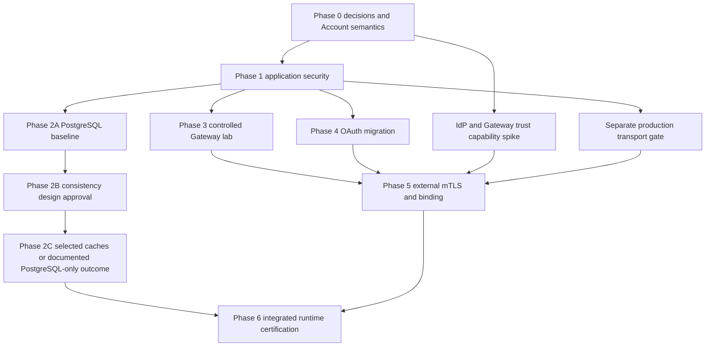

# Query Security and Cache Implementation Plan

Status: **planning only; no implementation phase or runtime execution authorized**.
Baseline: `9e68995233f49319974b76f826a59f88f14538cb` plus existing uncommitted work.
This plan implements the approved directions in the
[revised specification](../../services/docs/query-service/security-external-access-spec.md),
[decision register](../../services/docs/query-service/security-decision-register.md) and
[Account review](../../services/docs/query-service/account-summary-semantics-review.md).
GitHub Issues own execution state; this file owns planned scope and gates, not live checkboxes.

## 1. Phase dependencies and claim boundaries

Phases 2 and 3/4 need not wait for one another after their prerequisites, but only the approved
phase may be implemented. Lab application PASS is not a production transport PASS. Phase 6
aggregates phase evidence and cross-phase failures; essential phase tests are not deferred to it.
No new cache is a valid outcome if PostgreSQL-only meets requirements or correctness is unproven.

## 2. Phase 0 — decisions and bounded implementation readiness

1. Refresh HEAD/status and separate unrelated changes. Confirm actual dependencies/locks,
   Query HTTP routes, configuration authority, consumers and overlay output. Obtain the original
   finding/owning issue if available; do not invent issue scope or close it without evidence.
2. Resolve OD-01/02/04/17 and initial OD-03: M2M consumers, grant approval, emergency isolation,
   effective revocation/in-flight/rollback semantics and candidate SLO measurement. Name the
   policy provisioning source and precedence. Do not infer business authority from Kubernetes RBAC.
3. Resolve initial auth mode after checking IdP availability (OD-05/15). If directly selecting JWT,
   explicitly reapprove the Phase 1 scope rather than silently importing all Phase 4 work.
4. Approve the exact route/method matrix: sensitive reads, operator POST, minimal health,
   internal freshness/monitoring, Market Reference and default-denied routes. Resolve OD-10/11.
5. Approve the Phase 1 Account description under OD-19: current reservation-related projection,
   not balance aggregation. New domain semantics require a separate scope decision. Record
   external schema/monotonicity blockers without requiring a complete aggregate redesign to
   repair account authorization.
6. Choose lab-only or staging/production delivery; production needs OD-16 transport design.
   Identify compatibility changes and approved acceptance fixtures before editing implementation.

Gate: written decisions plus the exact Phase 1 slice are approved. Unselected production IdP,
Gateway and PKI details do not automatically block a lab security slice, but must remain
explicitly unclaimed. No production security secrets or numerical SLAs are invented.

## 3. Phase 1 — authentication, grants and PostgreSQL-only sensitive reads

### Acceptance contract

- Real HTTP security filters establish a registered principal before sensitive controller work.
- Explicit grants protect all three sensitive endpoints; parent order existence and trusted
  ownership precede executions; returned identities and each execution are checked.
- Sensitive Redis reads AND writes are absent from the response path, including old-key bypasses.
- Preserve operator-token separation, no implicit admin, no FIX privilege inheritance.
- Enforce 401/404/400/unavailable semantics, appropriate challenge and no-store responses.
- Validate policy snapshots and expose only nonsecret effective version. Exercise rotation,
  emergency isolation, interrupted rollout and anti-rollback under the approved initial contract.
- HTTP/PostgreSQL integration evidence is required, not only mocks/H2. Lab synthetic transport
  and production verified HTTPS are separate acceptance claims.

### Proposed small cohesive implementation slices

| Order | Work, tests first | Verification before advancing |
| --- | --- | --- |
| 1 | Add HTTP negative cases and validated principal/policy configuration. Separate credential identity, principal and explicit grants; immutable request policy snapshot. | Missing/disabled/ambiguous credentials, invalid UUID grants, rotation overlap, policy-version tests. |
| 2 | Wire framework authentication/security context using approved mode; explicit route/method allowlists, stateless behavior and no weaker default login scheme. | Real filter-chain 401 and malformed-input ordering; forged headers, FIX/operator credentials, unsupported methods/routes. |
| 3 | Introduce one cohesive authorized-read application module and thin controller. Reuse Query store; constrain detail reads by authorized resource/account; resolve parent/order race without assuming ownership immutability. | Two principals/two accounts, multiple grants, unknown/unauthorized indistinguishable 404, existing order with empty executions, inconsistent durable rows fail closed. |
| 4 | Remove sensitive cache read/write use; leave Market Reference under its separate approved correctness policy. Do not broadly delete Redis keys or rewrite Redis TLS/ACL work. | Preseed misleading sensitive cache values and verify HTTP results use only authorized PostgreSQL; Redis failure cannot change authorization. |
| 5 | Preserve rebuild authentication through explicit security-chain/CSRF rules; keep probes minimal. Update dedicated certification credentials, fixture selection, sensitive key-presence checks and docs. | Rebuild token cannot read accounts; read credential cannot rebuild; fixed granted fixtures; health/placement/internal consumers remain intentional. |
| 6 | Add the approved policy deployment/emergency procedure and, only if authorized, native HTTPS transport. | Multi-replica version/old-connection/in-flight/rollback evidence; production credential traffic only on verified encrypted channels. |

Authentication and grants should not become generic strategy frameworks. Public/non-obvious
Java members need Javadocs. Use records for simple immutable values and normal application
transaction ownership; keep JDBC in thin adapters. No Account schema joins, new online
entitlement service, distributed lock, OAuth server or Kafka entitlement stream.

### Compatibility and failure handling

Unauthenticated collectors become 401. Unknown execution parent changes from apparent empty
success to 404. Authenticated invalid UUID remains 400; unauthenticated invalid UUID is rejected
at authentication. Remove only sensitive-resource Redis key expectations, not all Redis tests.
Inventory external clients before promising payload compatibility. Old caches may remain unused;
restoring the old insecure application is not an approved rollback. Use a secure compatible
rollback or stop protected reads. Policy rollback cannot restore revoked grants.

## 4. Phase 2A — PostgreSQL-only performance baseline

Separate approval is required to run this workload. First read deployment preflight and classify
runtime inputs through the existing certification planner. Use isolated synthetic accounts and
approved resources; do not create another general-purpose benchmark/orchestration framework.

Measure each endpoint against the Phase 1 authenticated/authorized PostgreSQL-only path. Record
revision, dirty/clean source state, configuration, DB topology, replicas, pool sizes, dataset,
execution collection sizes, workload/concurrency, warmup, duration and error rates. Count JDBC
statements by ownership/detail/freshness/policy purpose and returned rows/bytes; collect p50/p95/
p99 latency, throughput, DB/pool load and authorization outcomes. Performance budgets/workload
targets must be approved; no percentage improvement or throughput value is invented here.

Compare order's single-row cost with execution-collection cost rather than assuming equal
benefit. Account cache stays off. Phase 2A completes with a reproducible baseline and endpoint
recommendation, not permission to cache. Any benchmark without security checks is noncomparable.

## 5. Phase 2B — consistency design and approval

Deliver four explicit contracts and a decision per endpoint:

| Contract | Required decisions and designed failure tests |
| --- | --- |
| Cache Consistency | Updates/deletion/rebuild/artifact replacement, age origin, visibility boundary, maintenance vs generation, Redis outage and interrupted reset. |
| Freshness Semantics | Snapshot-associated payload/checkpoints; internal vs external fields; atomic writer evidence and short read transaction; no Redis wait holding a DB connection. |
| Cache Concurrency | Delayed fill old/new revision race, eviction/expiry/miss, multiple replicas, stale generation, bounded request lifetime and chosen atomic condition. |
| Performance Acceptance | Per-endpoint JDBC hit/miss budgets, Redis counters, DB load and latency comparison to 2A under identical conditions; include new metadata-query and write costs. |

Evaluate controlled maintenance first: stop related admissions, drain HTTP requests/cache fills,
coordinate all consumers and other projection writers, reset/replay to declared boundary,
invalidate incompatible data, verify and resume. Existing scale-to-one procedure is evidence
of a starting point only. Explicitly test stuck drain, old terminating replica, Redis clear
failure and replay failure; define when service remains unavailable rather than exposing old data.

If maintenance cannot meet approved availability needs, compare durable generation fencing:
authority, atomic reset transition, request snapshot binding, multi-replica refresh and failure
behavior. Do not label old payload with a new generation. Schema changes require a separately
reviewed versioned Flyway migration, indexes and PostgreSQL tests; no migration is approved here.

For Account Summary, resolve OD-19 before cache design acceptance. Compare no cache, proven
resource revision plus atomic conditional fill, and any equivalent guarantee. Never use raw
timestamps/UUIDs/cross-partition offsets as invented order. Demonstrate B revision 11 fill then
A revision 10 fill cannot replace 11. Also evaluate post-eviction miss and non-overlapping client
reads; CAS does not retain a client's revision floor. If strict monotonic reads need a token,
define issuer, resource scope, epoch/reset, validation, wait/unavailable behavior and API costs.

Gate: approve meanings, chosen mechanisms, explicit unsupported guarantees, workload acceptance
and failure scenarios. Account remains PostgreSQL-only if semantics or revision cannot be proven.
Thirty seconds remains an unapproved candidate cache-age budget; no upstream authority freshness
SLA is inferred. Generation, CAS and minimum-revision tokens remain alternatives until selected.

## 6. Phase 2C — selective cache implementation

Implement only the endpoints justified by 2A and approved in 2B. Deferred full reads must not
defer authorization. Order/Executions still need trusted ownership and parent existence;
Account Cache requires its explicit revision gate. Validate typed cached identities and every
execution. Shared resource keys are allowed when all entitled principals see identical content.
Keep TLS/ACL and trusted writer isolation; JSON identity checks cannot defeat a compromised writer.

Example conditional warm-hit budgets: Account performs no full summary/freshness SELECT only
if its approved existence/age/version contract permits; Order/Executions perform required
ownership/generation validation but no full detail/collection read. Count every metadata query;
zero full reads does not mean zero database work. Cold misses and new revision-write overhead
must also be measured. Test actual adapter calls and PostgreSQL SQL evidence, not only mocks of
the intended call order. Use deterministic concurrency barriers, not timing-only sleeps.

Gate: CON-01–07 and all security invariants still hold, measured benefits justify costs, and
recovery/rollback preserve safe PostgreSQL-only behavior. A documented decision to retain
PostgreSQL-only for an endpoint is acceptable; do not report an unimplemented cache as delivered.

## 7. Later phases and capability boundaries

Phase 3: pinned controlled Gateway lab, route/method/host allowlist, attachment RBAC, CNI checks
and labeled per-proxy rate limits. No public insecure entry. Phase 4: approved issuer/profile,
JWKS behavior, principal mapping and explicit opaque retirement. Phase 5: entry capability spike
must demonstrate IdP certificate binding, supported Envoy metadata sanitation and Gateway-specific
backend identity; then implement final transport/binding with direct/legacy bypass rejection.
Phase 6: integrate failures, rotation, restoration and multi-replica evidence. None is authorized
by the documentation revision. Resolve remaining OD gates before dependent work.

## 8. Affected-file inventory for future approved work

All paths below are relative to repository root. New class names are suggestions only.

| Scope | Existing files / proposed additions |
| --- | --- |
| Phase 1 read | `services/query-service/src/main/java/com/simplematch/queryservice/web/QueryReadController.java`; new cohesive authorized-read module. |
| Phase 1 security/config | New principal/authentication/policy/security-chain classes; Query `config/QueryServiceProperties.java` or narrowly typed security properties; application profiles, `build.gradle.kts`, `gradle.lockfile`. |
| Phase 1 JDBC | Query `store/QueryProjectionStore.java`, `JdbcQueryProjectionStore.java`, `JdbcQueryProjectionReads.java`; ownership/account-constrained reads. |
| Phase 1 tests | `web/QueryReadControllerTest.java`, `store/JdbcQueryProjectionStoreTest.java`, application/config tests; new real HTTP security, policy and transport tests. |
| Phase 1 consumers | `scripts/end-to-end/query-service/lib/evidence.sh`, `run-certification.sh`, contract tests; inspect `scripts/lib/local-java-placement-serving.sh` and its tests for route policy compatibility. |
| Phase 1 deployment, only if approved | Query-specific properties/secrets/HTTPS/probes in Kustomize resources; respect pre-existing dirty changes. No Gateway/PKI rollout in this phase. |
| Phase 2 | Query `runtime/QueryReadCache.java`, `RedisQueryReadCache.java`, `QueryProjectionRebuildService.java`, read module, JDBC/model/tests; optional Flyway migration only for approved revision/generation design. |
| Semantics investigation only | `proto/account_v2.proto`, Account reservation/outbox writers, CDC configuration and tests; changing these requires separate domain scope approval. |
| Later phases | Dedicated Gateway resources/tests, Query NetworkPolicy, JWT/trust configuration, certificate/runbook fixtures; no implicit Phase 1 scope. |
| Documentation | Query spec/register/review/README, runtime config, operations and verification docs, owning issue once identified/authorized. |

## 9. Invariant-to-evidence requirements

All runtime evidence below is **required, not executed in this revision**. Existing test source
is a starting point only. Record actual commands, revision, environment, output, redacted
artifacts, restoration and residual limits for each future acceptance result.

| Invariant | Planned enforcement | Required test/evidence | Phase |
| --- | --- | --- | --- |
| INV-01 | HTTP authentication/security context | Real filters, missing/invalid/disabled credential, no unapproved scheme. | 1; extend 4/5 |
| INV-02 | Authorized-read module and scoped JDBC | Two principals/accounts, multiple grants, parent missing/empty, inconsistent ownership/rows. | 1 |
| INV-03 | Policy validation and default-deny route rules | Invalid policy activation, missing configuration, ambiguous principal, unknown routes/methods. | 1 |
| INV-04 | No sensitive cache in 1; authorized typed reads in 2C | Seed foreign sensitive keys; no reads/writes; later warm/cold/mixed-account cache and failed-ownership cases. | 1, 2C |
| INV-05 | Distinct credential/grant boundaries | FIX/rebuild credential misuse, arbitrary UUID and forged principal/account headers. | 1 |
| INV-06 | Query-enforced active security mode | Direct HTTP bypass first; final direct valid-JWT/no-binding and forged metadata rejected. | 1, 5 |
| INV-07 | Versioned policy and approved isolation | Multi-replica version, old connection/in-flight, warm-cache revoke, failed rollout and rollback; JWT/cert lifecycle separately. | 1, 4, 5 |
| INV-08 | Downstream-only dependency direction | Source dependency audit plus relevant existing critical-path isolation scenario under Query/security failure. | Relevant deployment phases |
| INV-09 | Verified certificate/token binding | A-cert/B-token, wrong thumbprint, missing cnf, wrong Gateway identity, legacy downgrade. | 5 |
| INV-10 | Gateway/application allowlists and RBAC | Host/method/path variants, extra route attachment, internal/rebuild/actuator rejection, actual CNI deny. | 3, 5 |
| CON-01 | Approved maintenance or generation | Old request late fill, active writer, interrupted reset/replay, Redis failure, multiple replicas. | 2B design / 2C runtime |
| CON-02 | Proven revision and atomic fill/equivalent | Deterministic concurrent GET revision 10/11 fill reversal; no older overwrite. | 2C |
| CON-03 | Proven projection order and any approved client floor | Sequential completed read then cross-replica read; eviction/miss/reset/restore and token-floor cases if selected. | Before account guarantee |
| CON-04 | Approved age/lag/freshness definitions | Delayed fill expiry, request timeout/clock assumptions, separately measured source lag and cache age. | 2C |
| CON-05 | Atomic writers and consistent read snapshot | PostgreSQL rollback injection plus concurrent writer/read snapshot test; no Redis wait holding DB connection. | 2B/2C |
| CON-06 | Endpoint-specific measured cache selection | 2A baseline vs 2C query/row/latency/load results under identical authorized workload. | 2A/2C |
| CON-07 | Typed cache validator and secure adapter | Corrupt/mismatched resource, mixed execution set, timeout/fallback, Redis TLS/ACL integration. | 2C |

## 10. Validation workflow and risks

After phase approval, write tests before implementation, run focused checks, the complete Query
suite and `./gradlew staticAnalysis` for Java changes. Use the existing Query `postgresJdbcTest`
runner with its supported PostgreSQL environment; do not assume a bare task invocation provisions
it. Reuse the existing Redis security runner only for approved Redis changes. Any deployment
test requires [preflight](../agents/deployment-test-lessons.md), source-aligned inputs and
[phase planner/reuse review](../verification/local-certification-phase-dag.md). Align executable
acceptance definitions/input fingerprints when semantics change, including sensitive key removal.

Primary risks are false balance semantics, unproven event ordering, failed revocation isolation,
auth-mode downgrade, untrusted proxy metadata, reset/fill races and unmeasured cache overhead.
Mitigate by the approval gates above, not by speculative platforms. Keep changes cohesive,
preserve public seams, avoid duplicated policy, generic context bags and suppressed warnings.
No test pass, deployment readiness or hard SLA may be inferred from this plan.
